# Job Search Panel

**In English.** A self-hosted job-search dashboard for [hh.ru](https://hh.ru), the largest Russian job board. It
searches vacancies through the official hh.ru API, filters them by your rules, and lets Claude evaluate each vacancy
and write a cover letter inside your own [Claude Code](https://claude.com/claude-code) session: the panel and Claude
exchange JSON packets through the `/hh-batch` command, so there are no LLM API calls and no API keys. You apply in
an assistant mode (the panel opens the hh.ru response page with the letter in the clipboard) or through the API
where hh.ru allows it, record employers' answers, and get Telegram notifications. It also reads public Telegram job
channels, company career sites, tenders of workspace.ru and development studios. Python, FastAPI, SQLite, React.
The interface is in Russian. Not affiliated with hh.ru. MIT license.

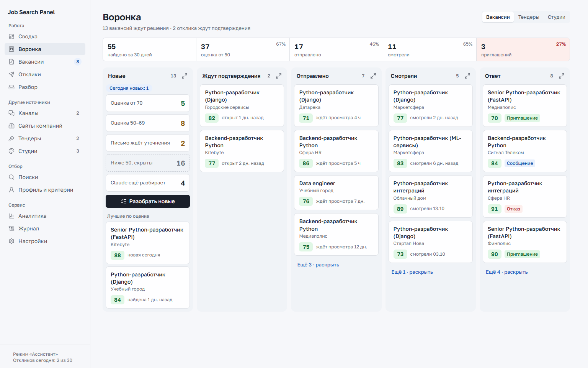

Панель для поиска работы на hh.ru, которая работает на вашем компьютере или своём сервере. Она находит вакансии по
вашим поискам, отсеивает лишнее правилами, отдаёт подходящие на оценку Claude в сеансе Claude Code, хранит
сопроводительные письма, помогает откликаться и следит за ответами работодателей. Уведомления приходят в Telegram.

Проект не связан с hh.ru (HeadHunter) и не одобрен им. Пользуйтесь им по правилам hh.ru: подробности в разделе
«[hh.ru и правила](#hhru-и-правила)».

## Что умеет

- **Поиск.** Сохранённые поиски hh.ru (текст на языке запросов hh, регионы, формат, зарплата, опыт) проверяются по
  расписанию. Новые вакансии проходят жёсткие правила анкеты (стоп-слова, зарплата, регион, формат) и получают
  предварительную оценку без LLM по весам ваших навыков.
- **Оценка и письма через Claude Code.** Подходящие вакансии панель складывает в пакеты, Claude разбирает их
  командой `/hh-batch`: оценка 0–100 с объяснением, что совпадает и чего не хватает, и письмо по фактам вашего
  профиля. Где фактов нет, Claude ставит пометку `[[УТОЧНИТЬ]]`, и такое письмо не уйдёт, пока вы его не допишете.
  Русские тексты проходят проверку скиллом humanizer-ru. Тем же обменом Claude готовит ответы работодателям, листы
  подготовки к собеседованию, ответы на вопросы формы отклика и правки резюме.
- **Отклики.** Режим «Ассистент»: панель открывает страницу отклика на hh.ru, письмо уже в буфере обмена, вы
  подтверждаете отправку. Режим API с очередью, паузами и лимитами работает там, где hh.ru разрешает его вашему
  приложению. Перед первым откликом панель просит согласие: отклики уходят от вашего имени.
- **Ответы работодателей.** Синхронизация с hh.ru, если метод доступен приложению; иначе ручной журнал (просмотр,
  приглашение, отказ, сообщение) и чтение писем hh.ru из почты по IMAP.
- **Воронка.** Этапы откликов на одной доске: колонки «Новые», «Ждут подтверждения», «Отправлено»,
  «Смотрели», «Ответ», воронка за 30 дней. Любая колонка раскрывается в рабочий список с оценкой, письмом и
  горячими клавишами. Те же доски есть для тендеров и студий.
- **Сводка и аналитика.** Конверсии, медиана реакции, динамика по дням, сегменты по поискам, должностям, навыкам и
  меткам, зарплаты, работодатели, тренды, «горячие» и «пограничные» вакансии, рекомендации: какие поиски завести,
  какие слова добавить в стоп-слова, какие навыки поднять.
- **Другие источники.** Публичные Telegram-каналы с вакансиями (через веб-версию `t.me/s/…`, без входа в Telegram),
  карьерные сайты нескольких компаний, тендеры workspace.ru на digital-услуги, студии разработки и дизайна с
  черновиками писем в двух стилях.
- **Telegram.** Новые подходящие вакансии, письма с кнопками «Да, отправлено», «Пропустить», «Отложить»,
  приглашения и отказы, вечерняя сводка, команды боту (`/status`, `/pause`, `/digest`, `/hot` и другие).
- **Работа на сервере.** Служба systemd на Linux, туннель с вашего компьютера, обновление и откат одной командой,
  копии базы вне сервера, вход из браузера по одноразовой ссылке от бота.

## Как устроено

```
hh.ru API ──► сканер ──► правила и предоценка ──► пакеты data/exchange/pending/
                                                       │
                              Claude Code: /hh-batch ◄─┘  (оценка, письмо, ответы)
                                                       │
data/exchange/done/ ──► импорт ──► вакансии и письма в панели ──► отклик на hh.ru
                                                                     │
          Telegram ◄── события ◄── синхронизация, ручной журнал, почта IMAP
```

- **Backend:** Python 3.11+, FastAPI, SQLAlchemy 2 и Alembic, SQLite в режиме WAL, APScheduler для фоновых задач,
  httpx. Клиент hh.ru сам следит за частотой запросов, повторами, ошибками, обновлением токенов и капчей.
- **Frontend:** React 18, TypeScript, Vite, Tailwind CSS 4, TanStack Query, иконки Lucide, шрифт Golos Text. Своя
  дизайн-система в `frontend/src/components/ui`, витрина компонентов на странице `/ui`.
- **Claude Code:** команда `/hh-batch` (`.claude/commands/hh-batch.md`) читает правила `data/exchange/guidelines.md`
  и профиль `data/exchange/profile.md`, пишет результат по JSON-схеме. По желанию панель запускает разбор сама через
  `claude -p` с узкими правами.
- **Проверки:** pytest (интеграционные тесты с моками hh.ru и Telegram), vitest и Testing Library, ruff, mypy в
  строгом режиме, GitHub Actions на Windows и Ubuntu.

```
backend/app/hh        клиент hh.ru: OAuth с PKCE, лимиты, повторы, ошибки, зонд возможностей, нормализация данных
backend/app/services  поиски, сканер, правила, оценки, письма, отклики, синхронизация, статистика, аналитика,
                      Telegram, каналы, сайты компаний, тендеры, студии, резервные копии, вход из браузера
backend/app/exchange  profile.md, guidelines.md, пакеты для Claude Code, импорт результатов, наблюдатель папки done/
backend/app/api       REST под /api
backend/app/db        модели SQLAlchemy и миграции Alembic
frontend/src          страницы и дизайн-система
deploy/linux          служба systemd, обновление и откат, проверка живости, копии, прокси Caddy
deploy/windows        remote.py: команды .\run.ps1 remote … для панели на сервере
.claude               команды /hh-batch и /setup, скилл humanizer-ru
```

## Что нужно заранее

- Windows 10/11 с PowerShell (основной сценарий, команды через `.\run.ps1`) или Linux/macOS (те же шаги вручную).
- Python 3.11 или новее, Node.js 20 или новее (только для сборки интерфейса), Git.
- Claude Code с подпиской: разбор вакансий идёт в вашем сеансе, ключ Anthropic API не нужен.
- Своё приложение на dev.hh.ru (ниже).
- Telegram-бот для уведомлений: создайте его у [@BotFather](https://t.me/BotFather). Панель работает и без него, но
  уведомлений тогда не будет.

## Приложение на dev.hh.ru

Панель работает только через ваше собственное приложение hh.ru, чужие `client_id` она не использует.

1. Войдите на https://dev.hh.ru/admin под своим аккаунтом соискателя и создайте приложение.
2. В поле **Redirect URI** укажите ровно `http://localhost:8000/api/auth/hh/callback`. Если меняете `APP_PORT` или
   адрес, впишите тот же адрес в `.env` (`HH_REDIRECT_URI`): протокол, хост, порт и путь должны совпадать.
3. После одобрения приложения перенесите `Client ID` и `Client Secret` в `.env` (`HH_CLIENT_ID`, `HH_CLIENT_SECRET`).
4. Впишите в `HH_USER_AGENT` название и свою почту: `JobSearchPanel/1.0 (you@example.com)` с вашим адресом. На
   заглушку hh.ru отвечает `400 bad_user_agent`. Почта уходит только в hh.ru, на другие сайты панель шлёт заголовок
   без неё.

С 15 декабря 2025 года hh.ru ограничил соискательские методы API, и что доступно конкретному приложению, заранее не
известно. Поэтому панель запускает зонд (Настройки → «Запустить зонд») и по его итогам выбирает режим. Поиск и
карточки вакансий она запрашивает токеном приложения. Если отклик через API закрыт, работает режим «Ассистент»;
если закрыт список откликов, ответы работодателей ведутся в ручном журнале или читаются из почты.

## Установка

### Windows

```powershell
git clone https://github.com/chaoseye/job-search-panel.git
cd job-search-panel
.\run.ps1 start
```

`run.ps1 start` создаст `.env` из `.env.example`, виртуальное окружение `backend/.venv`, поставит зависимости,
соберёт интерфейс и откроет http://localhost:8000/settings. Заполните `.env` (таблица ниже) и запустите снова.

Можно поручить установку Claude Code: откройте его в папке проекта и напишите `/setup`. Агент поставит зависимости,
соберёт интерфейс, запустит панель и проведёт по шагам, которые делаете вы сами (ключи hh.ru, вход, резюме, бот).
Команда `.\run.ps1 doctor` в любой момент показывает, что готово, а что нет, и не выводит секретов.

| Ключ в `.env` | Что вписать |
|---|---|
| `HH_CLIENT_ID`, `HH_CLIENT_SECRET` | из приложения на dev.hh.ru |
| `HH_USER_AGENT` | `JobSearchPanel/1.0 (ваша@почта)` |
| `TELEGRAM_BOT_TOKEN` | токен бота; `TELEGRAM_CHAT_ID` можно оставить пустым, панель определит его сама |
| `TIMEZONE` | ваш часовой пояс: по нему считаются окно отправки, лимиты и статистика |

Остальные настройки описаны прямо в `.env.example`.

### Linux и macOS

```bash
cp .env.example .env
python3 -m venv backend/.venv && backend/.venv/bin/pip install -e "backend[dev]"
(cd frontend && npm ci && npm run build)
(cd backend && .venv/bin/python -m uvicorn app.main:app --host 127.0.0.1 --port 8000)
```

Миграции базы применяются при старте. База, обмен с Claude, загруженные резюме и резервные копии лежат в `data/`,
логи в `logs/`; обе папки создаются сами и в git не попадают. Для постоянной работы на своей машине подойдёт systemd
user unit или launchd с последней командой; для сервера есть готовая служба (раздел «Работа на сервере»).

## Первый запуск

1. **Настройки → «Войти через hh.ru»** и подтвердите доступ на hh.ru. Входить нужно в браузере на той же машине:
   Redirect URI ведёт на localhost.
2. **«Запустить зонд»**: за несколько секунд панель проверит, какие методы доступны приложению, и выберет режим
   отклика. Отчёт сохраняется в `data/probe_report.json`.
3. **Профиль и критерии**: загрузите резюме (PDF-экспорт с hh.ru, DOCX, MD или TXT; из hh.ru, если метод доступен)
   и заполните анкету: целевые должности, стоп-слова, веса навыков, зарплата, формат, регионы. Из этого панель
   соберёт `data/exchange/profile.md` для Claude. Для разных направлений можно завести наборы критериев и привязать
   их к поискам; профиль и письма останутся общими.
4. **Поиски**: создайте один-пять запросов, нажмите «Проверить», затем «Запустить». Дальше сканер работает сам.
5. **Telegram** (Настройки): напишите боту `/start`, нажмите «Определить chat_id», затем «Тестовое сообщение».
6. Откройте Claude Code в папке проекта и выполните `/hh-batch`. Оценки и письма появятся на страницах «Вакансии»
   и «Воронка».

## Демо-данные

Чтобы посмотреть панель без входа в hh.ru, наполните пустую базу выдуманными данными: кандидат с резюме и анкетой,
поиски, около восьмидесяти вакансий на всех шагах (с оценками и письмами Claude), отклики с ответами работодателей,
тендеры, студии с письмами и Telegram-каналы. Компании, люди и сайты выдуманы, адреса сайтов на зарезервированном
домене `.example`, номера вакансий вне диапазона hh.ru. Скриншоты в этом README сняты на этих данных.

```powershell
$env:DATA_DIR = "$PWD\demo-data"     # отдельная папка, рабочую базу команда не трогает
.\run.ps1 demo-seed
.\run.ps1 start
```

На Linux и macOS из корня проекта: `export DATA_DIR="$PWD/demo-data"`, затем
`backend/.venv/bin/python -m app.cli demo-seed` и запуск панели командой из раздела «Установка».
Команда пишет только в пустую базу и отказывается работать рядом с запущенной панелью. Ничего наружу демо-данные не
отправляют: в них нет входа в hh.ru и токена бота. Чтобы вернуться к своим данным, уберите `DATA_DIR`.

## Разбор в Claude Code

После сканирования панель складывает кандидатов в `data/exchange/pending/` (по 12 вакансий в пакете). В Claude Code
в папке проекта выполните `/hh-batch`: Claude прочитает профиль и правила, оценит вакансии, напишет письма и сохранит
результат в `data/exchange/done/`. Панель импортирует его сама, кнопка «Импортировать сейчас» на странице «Разбор»
делает то же сразу.

**Без вашего участия.** Один раз выполните в терминале `claude` и войдите (`/login`), затем в `.env` включите
`CLAUDE_CLI_AUTORUN=true`. Панель будет запускать `claude -p "/hh-batch"`, когда появляются пакеты (раз в
`CLAUDE_CLI_TICK_MIN` минут), и сообщать в Telegram, сколько разобрано и сколько подходит. Фоновый разбор пишет только
в `data/exchange/done/` и `data/exchange/tmp/`, из команд ему разрешён только сканер humanizer-ru, а `.env`, база и
резервные копии ему не читаются. Тексты вакансий для него данные, а не инструкции: письма с похожими на секреты
фрагментами панель при импорте отклоняет.

**Стиль писем.** Русские письма Claude пишет по скиллу humanizer-ru (`.claude/skills/humanizer-ru`, лицензия MIT,
автор Ilya Utov). Панель проверяет импортированные и отредактированные письма тем же сканером (`HUMANIZER_CHECK`) и
показывает предупреждения в карточке вакансии.

## Страницы панели

| Страница | Что там |
|---|---|
| Сводка | показатели за период, письма с пометками `[[УТОЧНИТЬ]]`, графики, лента событий, экспорт CSV |
| Воронка | доски вакансий, тендеров и студий; колонка раскрывается в рабочий список с клавишами Enter, S, D, J/K |
| Вакансии | два вида на выбор: компактный (вкладки, фильтры в окне) и классический (все группы и фильтры сразу, таблица); карточка с оценкой, письмом и версиями, «Переделать в Claude», вопросы работодателя, история действий; добавление вакансий по ссылкам |
| Отклики | отправленные и ожидающие отклики, ручной журнал ответов, черновик ответа и подготовка к собеседованию через Claude |
| Разбор | пакеты для Claude Code, импорт, автономный запуск |
| Каналы | лента постов публичных Telegram-каналов, отбор похожих на вакансии, отправка в панель |
| Сайты компаний | вакансии с карьерных сайтов нескольких компаний (адаптеры в `services/company_sites.py`) |
| Тендеры | тендеры workspace.ru, совпадение с анкетой, отклик пишет Claude, публикуете вы |
| Студии | поиск студий разработки и дизайна, контакты с их сайтов, письма в деловом и простом стиле |
| Поиски, Профиль и критерии | запросы hh.ru, резюме, анкета, наборы критериев |
| Аналитика | сегменты рынка, навыки и пробелы, зарплаты, работодатели, тренды, рекомендации, правки резюме |
| Журнал, Настройки | события и задачи, пауза, вход в hh.ru, зонд, Telegram, письма hh.ru из почты, резервные копии |

Источники за пределами hh.ru устроены осторожно. Каналы читаются через публичную веб-версию без входа в Telegram.
Сайты компаний и студий панель читает без браузера, соблюдает `robots.txt` и не обходит защиту от роботов. Студиям,
найденным через hh.ru, панель предлагает только инициативный отклик: соглашение hh.ru разрешает использовать его
данные лишь для поиска работы. Письма студиям и отклики на тендеры вы отправляете сами.

## Telegram

События: новые подходящие вакансии, пакет ждёт разбора, импорт, отклик, приглашение, отказ, сообщение работодателя,
капча, вход, лимит, сбой задачи, вечерняя сводка, утренняя подборка «горячих», посты каналов, вакансии с сайтов,
тендеры, ответы студий. Набор задаёт `TELEGRAM_EVENTS`; однотипные события за пять минут склеиваются в одно
сообщение. Вакансия с письмом приходит отдельным сообщением с кнопками: «Да, отправлено» отмечает отклик в панели, а
вакансию, обработанную в панели, бот сам убирает из чата. Команды `/status`, `/pause`, `/resume`, `/digest`, `/hot`,
`/channels`, `/batch` принимаются только из вашего чата. Слова-исключения в настройках не пускают в бота вакансии с
этими словами в названии, в панели такие вакансии остаются.

## Команды

| Команда | Что делает |
|---|---|
| `.\run.ps1 start` | сборка интерфейса и запуск панели |
| `.\run.ps1 serve` | запуск без сборки и без браузера (для автозапуска) |
| `.\run.ps1 open` / `stop` | открыть панель, при необходимости запустив её без окна; остановить |
| `.\run.ps1 shortcut` | ярлык на рабочем столе |
| `.\run.ps1 autostart` / `autostart-remove` | задача планировщика Windows: запуск при входе |
| `.\run.ps1 doctor [--json]` | что установлено и настроено, без секретов |
| `.\run.ps1 demo-seed` | демо-данные в пустую базу |
| `.\run.ps1 probe`, `status` | зонд hh.ru, состояние входа и режима |
| `.\run.ps1 scan`, `sync`, `batch`, `import`, `apply` | скан, синхронизация, пакеты, импорт, очередь откликов |
| `.\run.ps1 stats`, `export`, `backup` | показатели, CSV, резервная копия |
| `.\run.ps1 dev`, `test`, `lint`, `check` | разработка: Vite и автоперезапуск, тесты, линтеры, все проверки |
| `.\run.ps1 remote …` | панель на сервере (раздел «Работа на сервере») |

При запущенной панели команды, которые меняют данные или ходят в hh.ru, выполняет сама панель через свой API: второй
экземпляр запросил бы у hh.ru свой токен приложения и отозвал бы токен работающей панели.

## Работа на сервере

Панель может постоянно работать на Linux-сервере (Ubuntu 24.04+, systemd), а вы открываете её с компьютера через
SSH-туннель или из браузера по ссылке от бота. Файлы: `deploy/linux` (сервер) и `deploy/windows/remote.py` (команды
`.\run.ps1 remote …` на вашем компьютере). Соглашение для служб сервера кладётся в `/srv/README`
(шаблон `deploy/linux/srv-README.md`).

### Как устроено на сервере

| Что | Где |
|---|---|
| Код | `/srv/jobsearchpanel/app`, git-копия выложенного коммита, владелец root |
| Секреты и данные | `app/.env` (600) и `app/data`, владелец служебный пользователь `jobpanel` |
| Служба | `jobsearchpanel.service` (`python -m app.server`): 127.0.0.1:8000 и при `PANEL_PUBLIC_URL` 127.0.0.1:8100 для прокси; песочница systemd, лимиты памяти и CPU |
| Интерфейс | собирается на вашем компьютере из того же коммита, Node на сервере не нужен |
| Проверка живости | `jobsearchpanel-health.timer` раз в две минуты, `jobsearchpanel-alert.service` при падении |
| Доступ | пользователь `jobremote`: только туннель на 127.0.0.1:8000 и выгрузка свежей копии |

**Одна панель.** Пока в `.panel-remote.json` стоит `panel_on_server: true`, `run.ps1` не запускает панель на вашем
компьютере: два экземпляра отзывают друг у друга токен приложения hh.ru и делят `getUpdates` бота. Ярлык и
`.\run.ps1 open` открывают туннель к серверу.

### Ключи

Настройки лежат в `.panel-remote.json` в корне проекта (в git не попадает):

```json
{
  "host": "203.0.113.10",
  "remote_user": "jobremote",
  "tunnel_key": "~/.ssh/jobpanel_tunnel",
  "deploy_key": "~/.ssh/jobpanel_deploy",
  "backup_key": "~/.ssh/jobpanel_backup",
  "backups_dir": "~/JobSearchPanel-backups",
  "panel_on_server": false
}
```

`.\run.ps1 remote keys` создаёт три ключа и печатает строки для сервера: ключ туннеля и ключ копий идут в
`/srv/jobsearchpanel/remote/.ssh/authorized_keys` пользователя `jobremote`, ключ развёртывания в
`/root/.ssh/authorized_keys2` с ограничением `command=` (только команды `deploy/linux/remote.sh`).

### Первичная установка

1. На компьютере: заполните `host` в `.panel-remote.json`, выполните `.\run.ps1 remote keys`.
2. Соберите пакет коммита (как это делает `remote deploy`: `git bundle` и архив `frontend/dist`), скопируйте его на
   сервер в `/srv/jobsearchpanel/incoming/<sha>/` и запустите от root
   `bash install.sh <sha> /srv/jobsearchpanel/incoming/<sha>`. Скрипт создаст пользователей и каталоги, код, venv,
   интерфейс, юниты (не запуская их), правило logrotate и `/srv/README`.
3. Положите строки из `remote keys` в файлы ключей. Если в sshd перенаправление запрещено глобально, положите
   `deploy/linux/sshd-jobsearchpanel.conf` в `/etc/ssh/sshd_config.d/10-jobsearchpanel.conf`, проверьте `sshd -t` и
   выполните `systemctl reload ssh`.
4. Установите Claude Code для пользователя службы (ниже) и перенесите данные: `.\run.ps1 remote move-to-server --yes`.

### Обновление и откат

`.\run.ps1 remote deploy [коммит]` собирает интерфейс из коммита (по умолчанию `origin/master`, только слитый в master
и с зелёным CI), отправляет `git bundle` и архив интерфейса, а на сервере `update.sh` ждёт окончания задач панели,
делает копию базы, переключает код, при необходимости ставит зависимости и юниты, перезапускает службу и проверяет
`/api/health`. Если панель не ответила за четыре минуты, возвращаются прежний коммит и интерфейс. Вручную вернуть
предыдущий коммит: `.\run.ps1 remote rollback`. Состояние: `remote status`, логи: `remote logs`.

### Переезд

`.\run.ps1 remote move-to-server --yes` ставит фоновые задачи на паузу, останавливает панель на компьютере, проверяет
базу и переносит на сервер `data/panel.db`, обмен с Claude, загрузки и `.env`; затем запускает службу и открывает
туннель. Токены hh.ru лежат в базе и переезжают вместе с ней. При старте панель сама переписывает пути файлов,
записанные прежней машиной. Обратно: `.\run.ps1 remote move-back --yes`.

### Правка .env на сервере

Отредактируйте `/srv/jobsearchpanel/app/.env` от root (владелец `jobpanel` и права 600 сохраняются), затем
`.\run.ps1 remote restart` и проверка `.\run.ps1 remote status`.

### Резервные копии

Ночную копию делает сама панель (`BACKUP_AT`, проверка целостности, 14 штук в `data/backups`). Вне сервера:
`.\run.ps1 remote pull-backup` забирает свежую копию ключом, который умеет только это, проверяет её и хранит сжатой в
`backups_dir`; `.\run.ps1 remote backup-task` создаёт задачу Windows, которая делает это каждый день. Проверка
восстановления на сервере: `bash /srv/jobsearchpanel/app/deploy/linux/restore-test.sh` поднимает копию второй панелью
на 127.0.0.1:8765 без входа в hh.ru и без бота и сверяет данные.

### Мониторинг

Ошибки задач панель шлёт в бота сама. Проверка живости перезапускает службу, которая трижды подряд не ответила на
`/api/health`, и сообщает об этом в бота; `OnFailure=` сообщает, если служба осталась лежать. Сообщения отправляет
`deploy/linux/notify.py` от имени пользователя службы. Для проверки снаружи укажите адрес пинга (например,
healthchecks.io) одной строкой в `/srv/jobsearchpanel/health-ping.url`.

### Claude Code

Установка для пользователя службы (root, один раз):
`setpriv --reuid=jobpanel --regid=jobpanel --init-groups --reset-env env HOME=/srv/jobsearchpanel/home bash -c 'curl -fsSL https://claude.ai/install.sh | bash'`.
Вход делает владелец подписки:
`sudo -u jobpanel -H sh -c 'cd /srv/jobsearchpanel/app && exec /srv/jobsearchpanel/home/.local/bin/claude'`, затем
`/login`. Проверка: `.\run.ps1 remote claude-check`. У службы отключено автообновление Claude Code, обновлять его
стоит вручную командой `claude update` от того же пользователя.

### Вход из браузера

Чтобы открывать панель с любого компьютера, задайте публичный HTTPS-адрес `PANEL_PUBLIC_URL` (например,
`https://panel.example.com`). Бот по команде `/open` присылает одноразовую ссылку на пять минут; страница по ссылке
показывает кнопку «Войти в панель», и браузер остаётся в панели `PANEL_SESSION_HOURS` часов. `/logout` в боте
закрывает все сессии, о каждом входе бот сообщает время, браузер и IP. Без входа публичный адрес отдаёт только
страницу входа, API отвечает 401. Доступ к панели становится равен доступу к вашему Telegram, поэтому включите в нём
облачный пароль. Вход в hh.ru и возврат после капчи работают только через туннель.

Включение:

1. DNS: A-запись домена панели на адрес сервера.
2. Caddy из официального репозитория (`dl.cloudsmith.io/public/caddy/stable`), ключ репозитория сверьте по
   отпечатку с документацией Caddy.
3. `ufw allow 443/tcp`.
4. `PANEL_PUBLIC_URL=https://<домен>` в `.env` сервера и перезапуск службы.
5. `bash /srv/jobsearchpanel/app/deploy/linux/proxy.sh install <домен>`: сайт Caddy, ограничения службы, закрепление
   репозитория в apt, проверка конфигурации, ожидание сертификата и ответа панели. Состояние: `proxy.sh status`,
   откат: `proxy.sh remove`.

### Ограничения Caddy

Caddy остаётся единственной службой, открытой в интернет, поэтому `proxy.sh install` ограничивает её drop-in
`caddy.service.d/10-jobsearchpanel.conf` (шаблон `deploy/linux/caddy/caddy-hardening.conf`): из прав только
`CAP_NET_BIND_SERVICE`, файловая система только на чтение, кроме `/var/lib/caddy`, фильтр системных вызовов,
перезапуск при сбое, лимиты памяти и CPU. Файл `/etc/apt/preferences.d/caddy-cloudsmith` разрешает брать из
репозитория Caddy только сам пакет `caddy`. Журнала запросов у Caddy нет намеренно: в адресе ссылки входа есть токен.

## Разработка

| Что | Команда |
|---|---|
| Режим разработки | `.\run.ps1 dev` (uvicorn с автоперезапуском и Vite на 5173; в `.env` `FRONTEND_URL=http://localhost:5173`) |
| Тесты | `.\run.ps1 test`; только backend: `cd backend; .venv\Scripts\python -m pytest -q -n auto` |
| Все проверки, как в CI | `.\run.ps1 check`: сборка и тесты интерфейса, ruff, `ruff format --check`, mypy, pytest |
| Хуки pre-commit | `.\run.ps1 precommit` |

Конвенции: все запросы к hh.ru идут через `HHClient`; методы, которых нет в публичной спецификации hh.ru, вызываются
только после подтверждения зондом; время хранится в UTC; миграции лежат в `backend/app/db/migrations/versions`;
изменяемые из интерфейса настройки хранятся в таблице `settings`, статические в `.env`.

### Дизайн-система

Токены (цвета OKLCH, шесть размеров текста, тени слоёв) описаны в `frontend/src/index.css`, компоненты лежат в
`frontend/src/components/ui`, все они в своих состояниях показаны на странице `/ui`. Одна главная кнопка на экран,
пустой список объясняет причину и даёт одно действие, таблица прокручивается вбок внутри своего блока, страница вбок
не прокручивается никогда. Каждую страницу стоит проверять на ширине 1280–1536 px и на телефоне.

### Подводные камни

- `run.ps1` хранится в UTF-8 с BOM и CRLF: Windows PowerShell 5.1 без BOM читает кириллицу неверно.
- `backend/alembic.ini` должен оставаться ASCII.
- У SQLite один писатель: фоновые задачи не держат транзакцию записи открытой во время запросов к hh.ru.
- Tailwind 4: свои классы через `@apply` не подключаются, только встроенные утилиты.

## Безопасность и ограничения

- Секреты лежат только в `.env` и в локальной базе; в логах, ответах API, экспорте и Telegram их нет. `.env` в
  `.gitignore`, хук pre-commit не даёт его закоммитить.
- Панель слушает 127.0.0.1 и отвечает только на свои имена: чужой заголовок `Host` получает 400, изменяющий запрос со
  страницы другого сайта получает 403.
- Панель соблюдает лимиты hh.ru и свои, более строгие, не откликается без подтверждения (если вы сами не включили
  автопилот) и не отвечает работодателям за вас.
- Если метод hh.ru недоступен приложению (403), панель отмечает его и переходит на запасной путь: резюме из файла,
  режим «Ассистент», ручной журнал ответов.

## hh.ru и правила

Проект не связан с hh.ru (HeadHunter), не одобрен и не поддерживается им; «hh.ru» и «HeadHunter» упоминаются
только как название сервиса, с которым работает панель. Панель использует официальный API hh.ru через ваше собственное
приложение и ваш вход. Она не эмулирует браузер, не обходит капчу и лимиты и не использует чужие `client_id`.

Перед использованием прочитайте [соглашение для разработчиков](https://dev.hh.ru/admin/developer_agreement) и правила
сайта. Данные hh.ru можно использовать только для поиска работы, без рекламных рассылок. За отклики, отправленные от
вашего имени, и за соблюдение правил отвечаете вы.

## Скриншоты

Все снимки сделаны на демо-данных (раздел «Демо-данные»), личных данных в них нет.

| | |
|---|---|
| 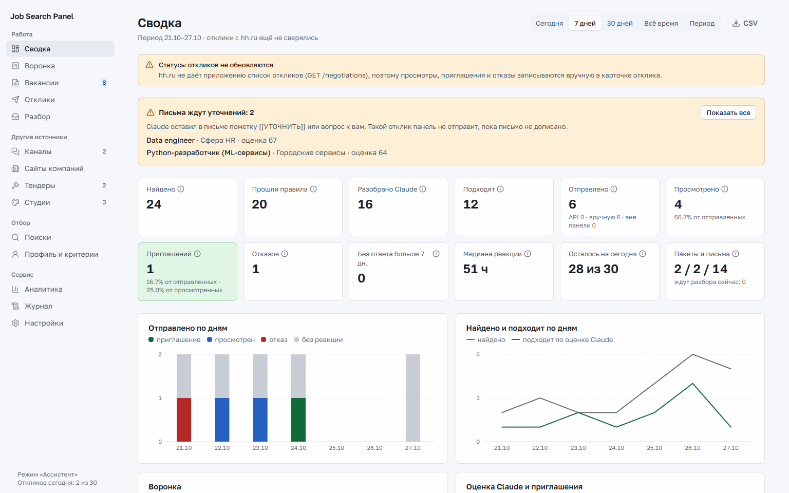 Сводка | 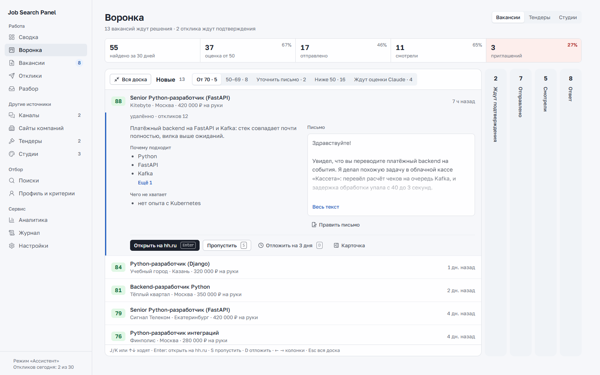 Воронка: раскрытая колонка «Новые» |
| 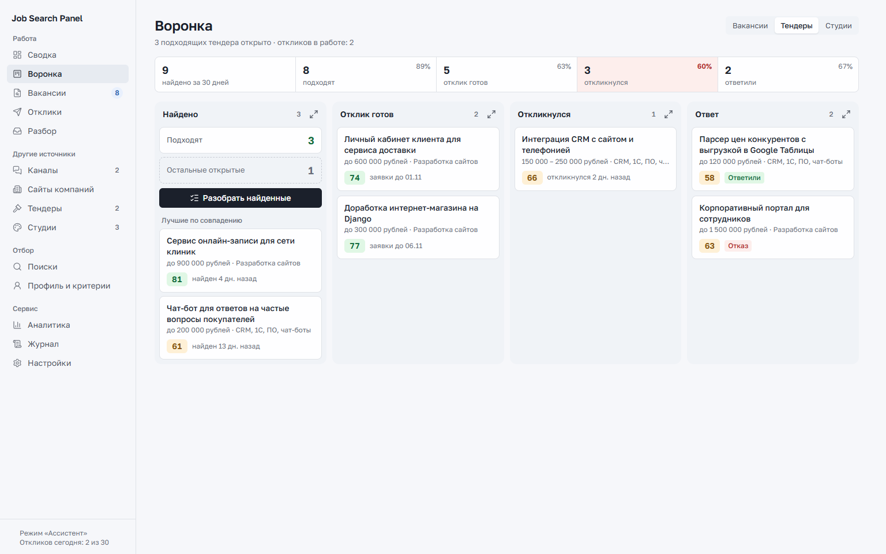 Воронка тендеров | 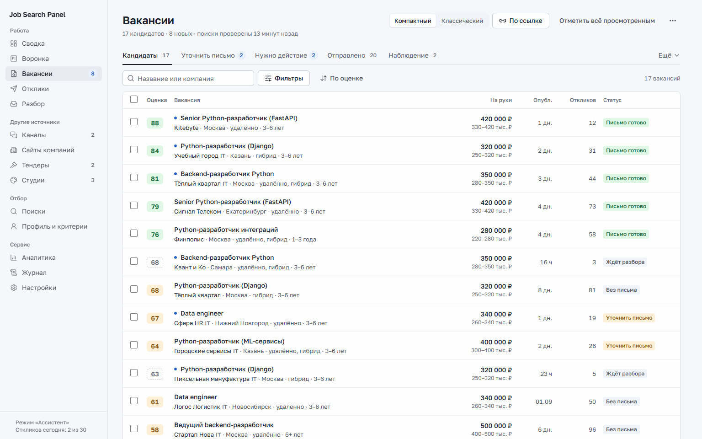 Вакансии, компактный вид |
| 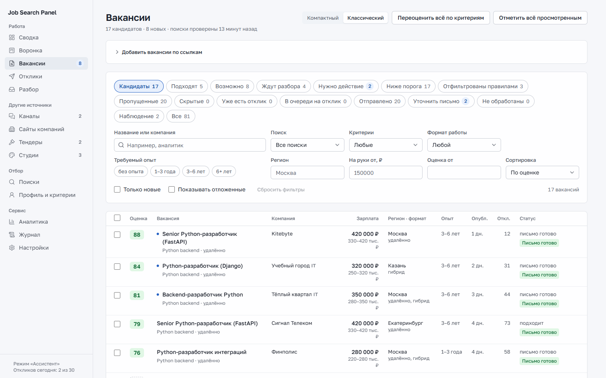 Вакансии, классический вид | 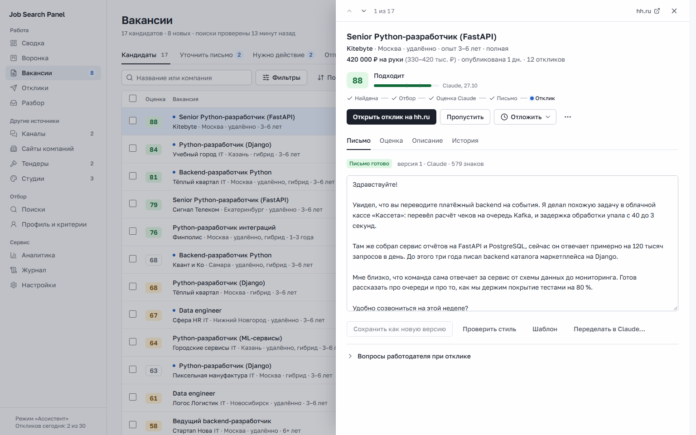 Карточка вакансии: письмо Claude |
| 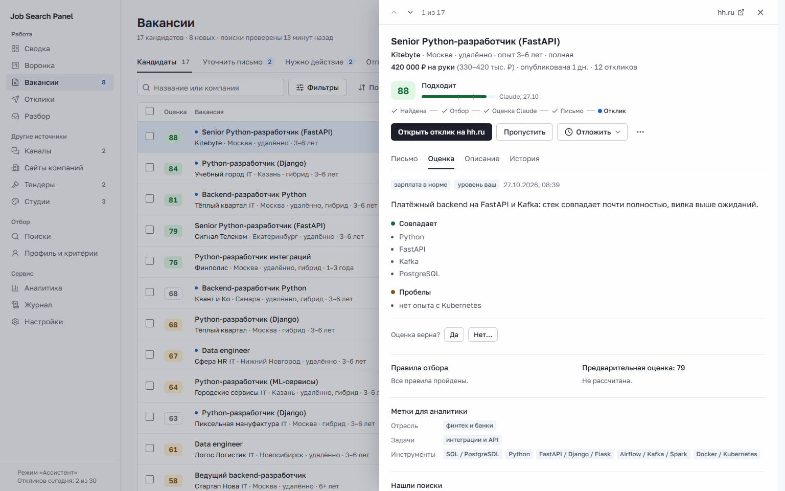 Карточка вакансии: оценка Claude | 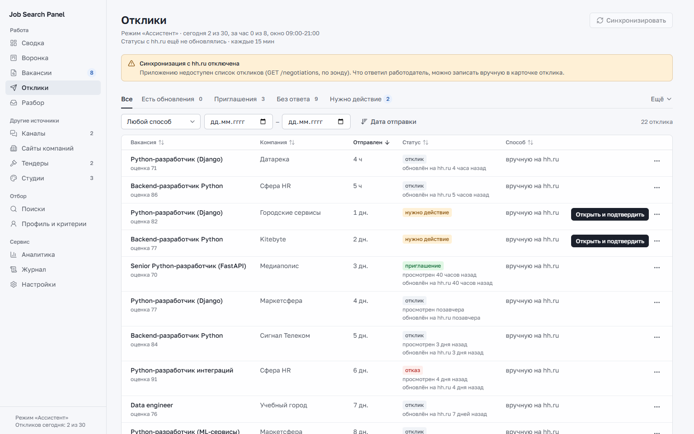 Отклики |
| 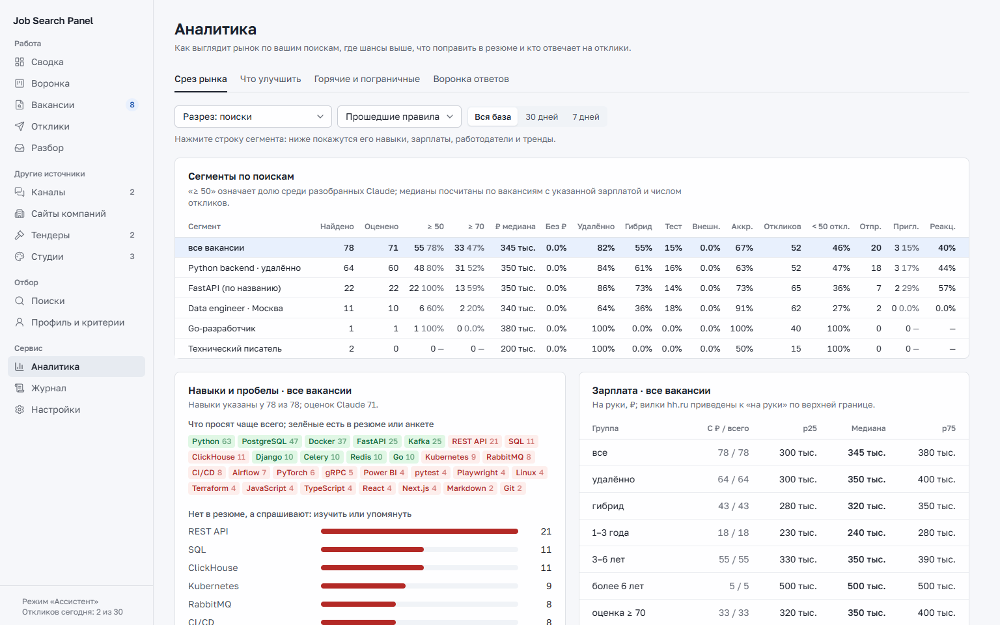 Аналитика | 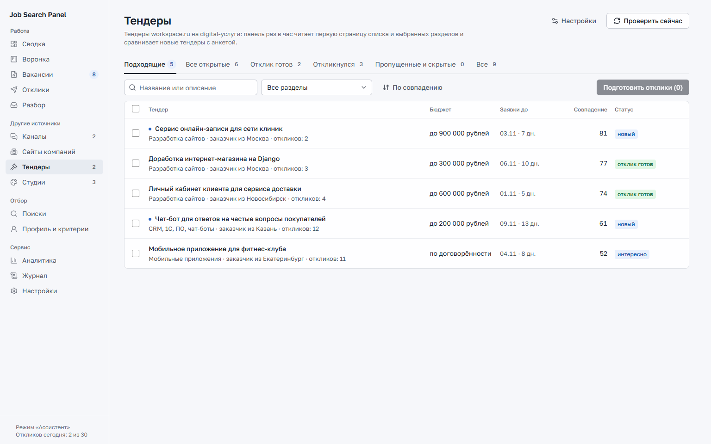 Тендеры |
| 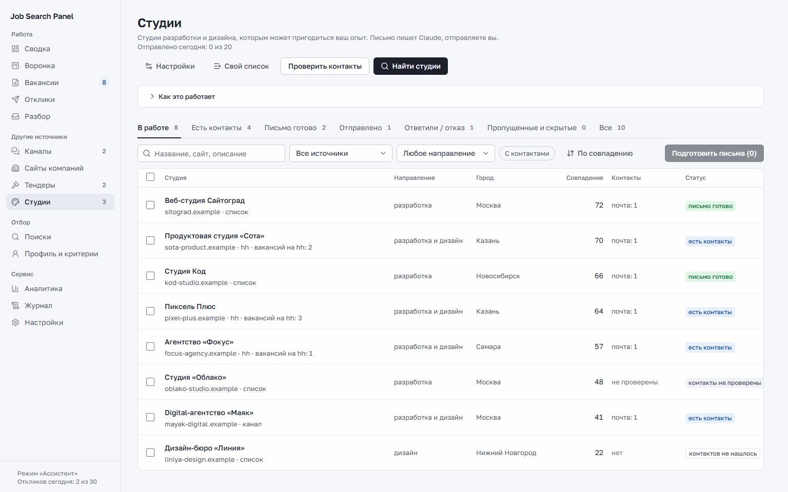 Студии | 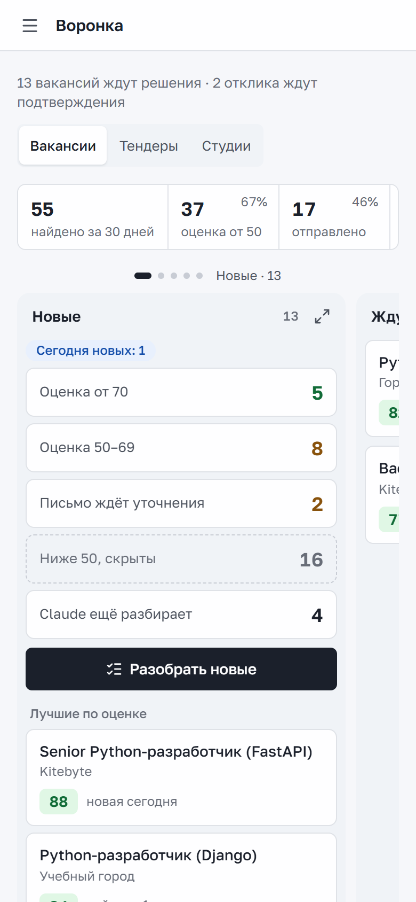 Воронка на телефоне |
| 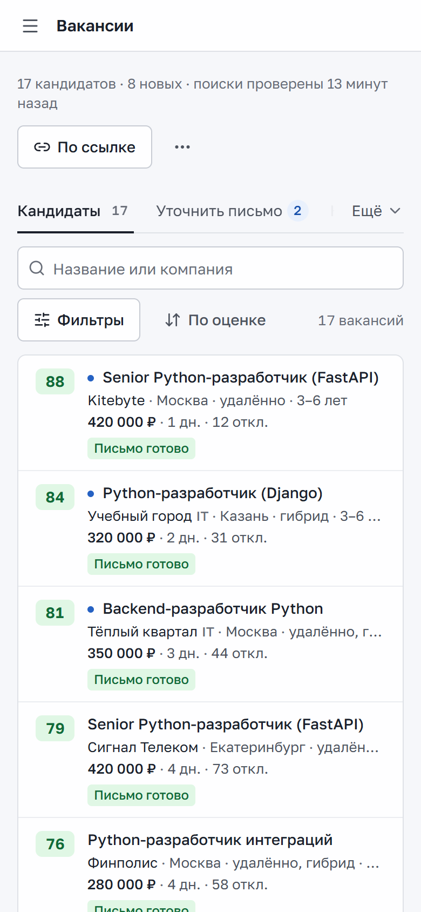 Вакансии на телефоне | 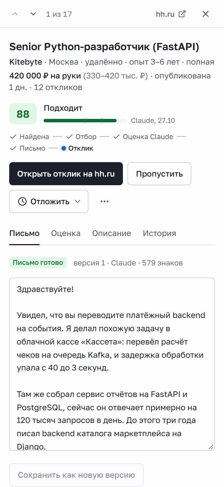 Карточка на телефоне |

## Лицензия

[MIT](LICENSE). Скилл humanizer-ru в `.claude/skills/humanizer-ru` распространяется под своей лицензией MIT
(`.claude/skills/humanizer-ru/LICENSE`).
